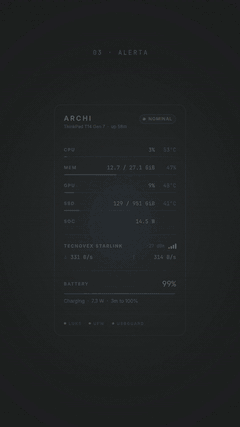
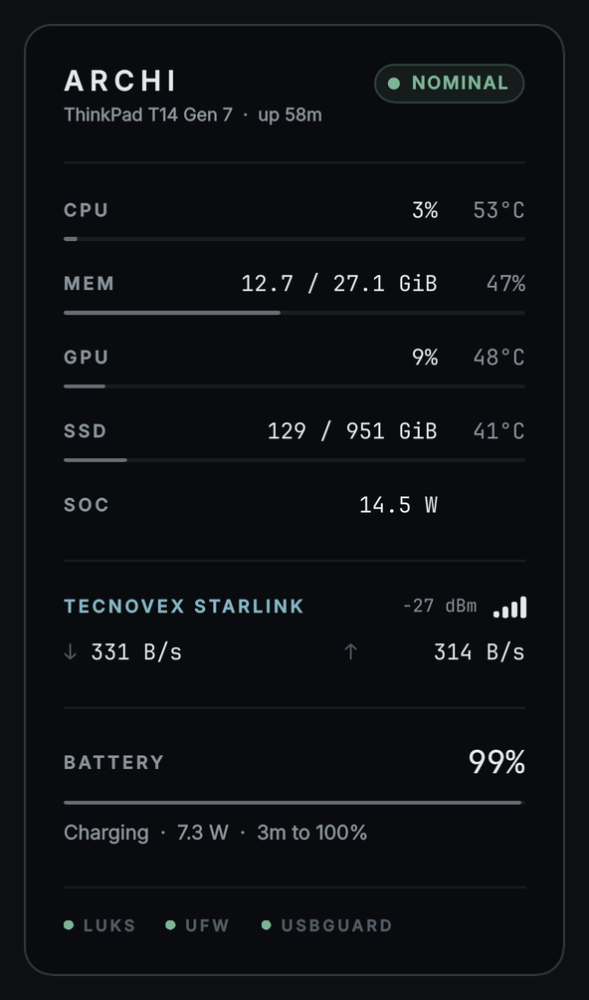
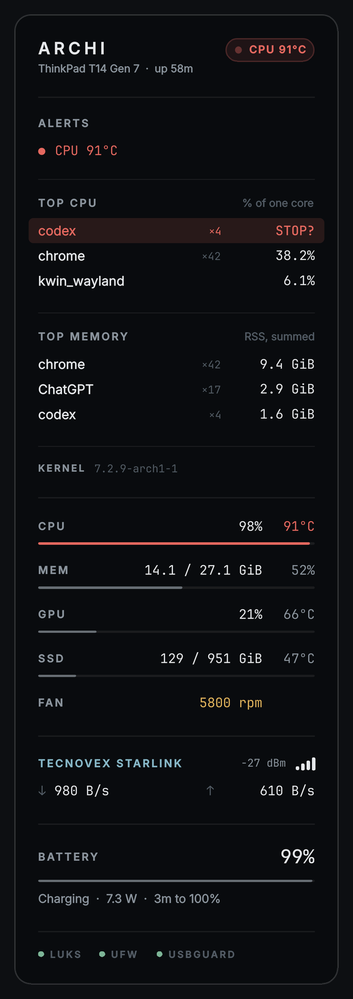

# Archmonitor

Monitor de recursos nativo para **KDE Plasma 6** (Wayland): una tarjeta sobria en el escritorio que se queda en silencio mientras todo está bien y avisa solo cuando algo se sale de rango.

<p align="center">
  <a href="docs/archmonitor-reel.mp4"></a>
  
  
</p>

<p align="center"><a href="docs/archmonitor-reel.mp4"><b>▶ Ver el video completo (27 s)</b></a></p>

- **Sistema:** CPU, RAM, GPU y disco, con temperaturas, potencia del SoC y ventilador cuando hace falta.
- **Red y batería:** enlace físico, señal Wi-Fi y tasas; carga, potencia y tiempo restante.
- **Alertas que no parpadean:** persistencia e histéresis; `STALE` si la telemetría deja de llegar y `?` cuando algo importante no se puede medir.
- **Procesos:** un clic abre el cajón con los mayores consumidores de CPU y RAM; dos clics detienen el que está frenando todo (SIGTERM y, si se resiste, SIGKILL).
- **Seguridad:** LUKS sobre `/`, firewall (ufw, firewalld, nftables o iptables), USBGuard y reinicio pendiente tras actualizar el kernel.
- **Música:** lo que suena en el navegador, con carátula, pausa y siguiente.

## Instalación

Requiere Arch Linux (o derivada) con KDE Plasma 6.

### Desde el archivo `.plasmoid`

Bajá `archmonitor-X.Y.Z.plasmoid` de [Releases](https://github.com/fabio-integranode/archmonitor/releases/latest) y:

```bash
sudo pacman -S --needed inter-font ttf-jetbrains-mono iw playerctl
kpackagetool6 -t Plasma/Applet -i archmonitor-*.plasmoid      # primera vez
kpackagetool6 -t Plasma/Applet -u archmonitor-*.plasmoid      # para actualizar
systemctl --user restart plasma-plasmashell
```

O sin terminal: clic derecho en el escritorio → *Añadir elementos gráficos* → *Obtener elementos gráficos nuevos* → *Instalar elemento gráfico desde archivo local…*.

`plasmapkg` / `plasmapkg2` eran de Plasma 4 y 5; en Plasma 6 la herramienta es `kpackagetool6`. Si tras actualizar algo se ve como antes, borrá la caché de QML: `rm -rf ~/.cache/plasmashell/qmlcache` y reiniciá plasmashell.

### Desde el código

```bash
sudo pacman -S --needed inter-font ttf-jetbrains-mono iw playerctl
git clone https://github.com/fabio-integranode/archmonitor.git
cd archmonitor
./install.sh && systemctl --user restart plasma-plasmashell
```

Después: clic derecho en el escritorio → *Añadir elementos gráficos* → **Archmonitor**. Arrastralo a una esquina.

Para actualizar: `git pull && ./install.sh && systemctl --user restart plasma-plasmashell`.

`install.sh` además avisa qué dependencias opcionales faltan, borra la caché de QML y retira un Conky previo. `./package.sh` arma el `.plasmoid` en `dist/` (sólo `metadata.json`, `contents/` y la licencia).

`iw` (nombre de la red Wi-Fi) y `playerctl` (barra de música) son opcionales: sin `iw` la tarjeta muestra la interfaz y la señal; sin `playerctl` no hay barra. `lm_sensors` no hace falta. `findmnt` (util-linux) y `getconf` (glibc) ya vienen con Arch.

En *Configurar Archmonitor…*: opacidad del fondo y qué **exige** esta máquina en seguridad (ver abajo).

## Compatibilidad

Nada está atado a un equipo: cada sensor se busca por el nombre de su driver (los índices `hwmonN` cambian entre arranques) y lo que la máquina no tiene, no se muestra.

| | Fuentes, en orden de preferencia | Si no hay ninguna |
|---|---|---|
| **CPU °C** | `k10temp` / `zenpower` (AMD: Tdie, si no Tctl), `coretemp` (Intel: paquete), `cpu_thermal` (ARM), zona térmica `x86_pkg_temp`. `acpitz` no se usa: en muchos equipos es una zona de placa o una constante. | `—`, sin alerta |
| **GPU** | NVIDIA despierta (`nvidia-smi`), `amdgpu` (la primera que responde), Intel `i915`/`xe` (frecuencia real contra la máxima: no exponen % de uso), `nouveau`. Una NVIDIA dormida (portátil híbrido) **no se despierta**: consultarla cada 2 s gastaría batería; se muestra `sleep` o la GPU integrada. | fila oculta |
| **SSD °C** | `nvme`, si no `drivetemp` (SATA: `sudo modprobe drivetemp`) | en blanco |
| **Ventilador** | el más rápido que informe cualquier driver (`thinkpad`, `dell_smm`, `asus`, `nct67xx`, `it87`…) | la fila `FAN` no aparece |
| **Potencia** | APU AMD: potencia del paquete (`SOC`). La potencia de placa de una GPU discreta no se muestra. | fila oculta |
| **Batería** | la primera batería del sistema (`type=Battery`; mouse y auriculares se ignoran), en unidades de energía o de carga | sección oculta |
| **Modelo** | DMI (`product_version` en Lenovo, `product_name` en el resto, `board_name` en equipos armados), descartando los textos de relleno del firmware; device tree en ARM | sólo el uptime |
| **Wi-Fi** | `iw` (SSID y señal), si no `/proc/net/wireless` (señal) | nombre de la interfaz |

Para ver qué encontró en tu equipo:

```bash
bash ~/.local/share/plasma/plasmoids/io.arquimedes.archimonitor/contents/code/archi-stat.sh | jq .src
```

El aviso de reinicio pendiente depende del empaquetado de kernels de Arch (`pkgbase`); en otras distribuciones queda en silencio.

> El identificador interno del widget sigue siendo `io.arquimedes.archimonitor`, para que las instalaciones existentes se actualicen en el lugar.

## Arquitectura

| Archivo | Rol |
|---|---|
| `contents/code/archi-stat.sh` | Sonda: lee `/proc` y `/sys` y emite JSON. Tres modos: rápido (2 s, ~10 ms), `sec` (30 s) y `top` (bajo demanda, ~1 s). |
| `contents/ui/main.qml` | Wrapper Plasma: muestreo, deltas (CPU %, red) y estado del motor de alertas. |
| `contents/ui/Card.qml` | Tarjeta del escritorio. Vista pura; un clic abre o cierra el cajón de detalle bajo el encabezado. |
| `contents/ui/Detail.qml` | Contenido del cajón: alertas activas, procesos por CPU y RAM, kernel. Sin fondo propio: es parte de la tarjeta. |
| `contents/ui/Logic.js` | Umbrales, formato y motor de alertas (persistencia + histéresis). |
| `tests/` | `test_logic.js` (motor), `test_probe.sh` (sonda) y `test_hw.sh` (hardware y seguridad de otras máquinas). |

## Semántica

- **Pill de estado**: `NOMINAL` o el peor hallazgo, más `+N` si hay más. Orden: `STALE` > crítico > advertencia > desconocido. Sólo late en crítico.
- **STALE**: si pasan más de 7 s sin una muestra válida (la sonda falló, se colgó o el JSON no parsea), la pastilla pasa a `STALE 12 s` en gris y las cifras se atenúan. Nunca se muestra `NOMINAL` con datos viejos. Lo vigila un único `Timer` de 1 s: detectar que algo *no* llegó requiere un reloj.
- **Desconocido (`?`)**: no medir no es estar bien. Impiden `NOMINAL` un sensor de CPU que **estaba y dejó de responder** (`CPU TEMP ?`; un equipo que nunca lo tuvo, como una VM, muestra `—` sin alerta) y la sonda de seguridad callada (`SECURITY ?`, si no reporta o tiene más de 90 s). Un control exigido que no se puede determinar se muestra `FIREWALL ?`, `USBGUARD ?` o `LUKS ?`, nunca como caído.
- **Persistencia**: una alerta aparece tras 3 muestras consecutivas (6 s) en el peor nivel sostenido. Un pico aislado no dispara nada.
- **Histéresis**: una alerta se libera sólo cuando el valor cruza el umbral con margen (por ejemplo, CPU entra a 80 °C y sale por debajo de 77 °C). Un valor oscilando sobre la línea no hace parpadear la pastilla.
- **Alertas**: temperaturas, presión de memoria y disco, batería baja en descarga, señal débil, sin red, seguridad (abajo) y reinicio pendiente. La carga de CPU no es una anomalía y no alerta.
- **Seguridad**: la sonda distingue, por servicio, *activo*, *caído* (habilitado o fallado pero sin correr), *apagado* (instalado y sin uso), *no instalado* y *desconocido*. `systemctl is-active` no sirve para esto: responde `inactive` tanto para un servicio detenido como para uno que no existe.
  - Un servicio **caído** siempre alerta (`UFW DOWN`, `FIREWALLD DOWN`, `USBGUARD DOWN`): alguien quiso que corriera y no corre.
  - Lo demás depende de qué **exige** esta máquina (configuración → *Seguridad*, todo desmarcado por defecto). Exigido: no tener firewall (`NO FIREWALL`), USBGuard apagado o ausente, `/` sin cifrar (`LUKS OFF`) o una respuesta imposible (`?`) alertan. No exigido: se muestran como un punto hueco, sin alerta. USBGuard no instalado y no exigido ni aparece.
  - Firewall: gana el que esté corriendo de `ufw`, `firewalld`, `nftables` e `iptables`; si ninguno corre, uno habilitado se reporta caído. `nftables.service` e `iptables.service` vienen con paquetes comunes, así que instalados sin habilitar no dicen nada de intención.
- **Color**: sólo en la cifra que supera su umbral. Todo lo demás es monocromo.
- **Clic en la tarjeta**: abre, justo bajo el encabezado, un cajón con todas las alertas y los 3 mayores consumidores de CPU y de RAM; las métricas bajan con una animación de 200 ms. Otro clic lo cierra. No hay popup de Plasma.
- **Música**: al pie de la tarjeta, sólo mientras un navegador reproduce o tiene en pausa algo (Firefox, Chromium, Chrome, Brave, Vivaldi, Edge…; Spotify y otros reproductores se ignoran). Un bloque 16:9 con la carátula a todo el ancho (recortada, no deformada) y un degradado sutil desde abajo; encima, centrados, anterior / reproducir-pausa (un único botón que alterna) / siguiente, cada uno con su disco oscuro y borde claro para leerse sobre cualquier imagen; abajo, el progreso con el tiempo **restante** (`-3:42`) y el título con artista en marquesina de bordes desvanecidos si no entra. Con YouTube / YouTube Music, si la extensión no publica la carátula (lo hace tarde tras un cambio de pista, hasta el próximo pausa/play), se usa la miniatura del propio video a partir del enlace de la página; una carátula publicada siempre tiene prioridad, y mientras sea la misma pista la carátula se conserva aunque el reproductor la deje de informar. Clic en la carátula o el título trae el navegador al frente; con la extensión **Plasma Browser Integration** enfoca la pestaña exacta. Lee MPRIS cada 2 s con `playerctl`; play/pausa cambia al instante y la posición avanza localmente entre sondeos. Sin `playerctl` no aparece. Las esquinas redondeadas de la carátula y el desvanecido usan la GPU; con renderizado por software se dibujan sin efecto.
- **Detener un proceso** (en el cajón, filas de CPU o de memoria): primer clic arma la fila (`STOP?` en rojo), segundo clic envía **SIGTERM** a todos tus procesos de ese comando (`×12` = los doce). La fila muestra `stopping…` 3 s; si el comando sigue en la lista, el siguiente intento ofrece `KILL -9?` (**SIGKILL**). Un SIGTERM de más de 60 s se olvida. Cualquier otro clic, 4 s sin confirmar o cerrar el cajón desarma la fila.
  - Sólo procesos tuyos: el widget corre con tu usuario y no escala privilegios.
  - Nunca se ofrecen los que tumbarían la sesión, el escritorio (y el propio widget), el audio, los llaveros o una shell: `plasmashell`, `kwin_wayland`, `Xwayland`, `systemd`, `dbus-*`, `pipewire`, `wireplumber`, `kwalletd6`, `bash`/`zsh`/`fish`, entre otros (`protected_name()` en la sonda). Esas filas no se arman.
  - La sonda revalida cada PID al enviar la señal: vivo, mismo nombre de comando, tuyo, no PID 1. Un PID reutilizado desde la muestra falla la comprobación de nombre.
  - CPU se mide en una ventana de ~1 s desde `/proc/PID/stat`; es % de **un** núcleo (como `top`), por eso puede superar 100 %.
  - Los procesos se agrupan por comando (`×9` = nueve procesos). La RAM es RSS sumado, así que las páginas compartidas se cuentan una vez por proceso: es aproximada y tiende a sobrestimar navegadores.
  - La sonda `top` sólo corre mientras el detalle está visible.
- **LUKS**: se resuelve el dispositivo que respalda `/` y se recorre su cadena (`slaves/`) buscando un mapeo `CRYPT-LUKS*`. Cubre LUKS directo y LVM sobre LUKS. Un LUKS que protege sólo `/home` ya no da positivo.
- **Reinicio pendiente**: se activa si el árbol `/usr/lib/modules/<kernel en ejecución>` ya no existe (lo borra el upgrade) o si hay instalado un kernel más nuevo del mismo paquete (`pkgbase`). Si el kernel no viene de un paquete de Arch, no puede saberlo y se queda callado. Con `linux-lts` instalado junto a `linux` no se mezclan.
- **GPU**: ocupación donde el driver la da (AMD `gpu_busy_percent`, NVIDIA); en Intel, MHz reales contra el máximo (0 MHz = en reposo, RC6). En AMD `sclk` en reposo marca ~0 por GFXOFF, por eso no se usa.
- **Fila contextual** (altura fija, la tarjeta nunca cambia de tamaño): `FAN` en ámbar cuando la CPU ≥ 70 °C (sale bajo 65 °C) o el ventilador supera 4000 rpm; si no, `SOC` (potencia del paquete APU), tenue en reposo y normal en batería, cargando o por encima de 15 W (sale bajo 12 W). En un equipo sin sensor de ventilador ni potencia de paquete la fila no se reserva.
- **Red**: se toma el enlace físico, la ruta por defecto activa (`RTF_UP`) de menor métrica en `/proc/net/route` (Ethernet del dock a métrica 100 gana al Wi-Fi a 600). Los túneles VPN enrutan por otras tablas y no se eligen a propósito: SSID y señal son del enlace físico.
- **SSID**: `iw` escapa los bytes no ASCII como `\xNN`; se decodifican, así que «Señal» se ve bien. Todo texto pasa por un escape JSON completo (incluye caracteres de control).
- **Batería**: `Not charging` con umbral de carga (ThinkPad, ASUS y otros con `charge_control_end_threshold`) se muestra como `AC · held at N%`.

Los umbrales se ajustan en `Logic.js` (`TH`, `RULES`, `UP`). Para aplicar cambios: `./install.sh` y reiniciar plasmashell.

## Pruebas

```bash
node tests/test_logic.js     # 42 casos: persistencia, histéresis, política de seguridad, STALE, desconocidos, vistas, señales, música
bash tests/test_probe.sh     # 42 casos: LUKS, reinicio, ruta, SSID/escape, top, kill, música, JSON, uptime
bash tests/test_hw.sh        # 28 casos: portátil AMD, Intel (i915/xe), escritorio armado, NVIDIA híbrida, ARM, VM, Wi-Fi sin iw, firewalls
```

`test_hw.sh` arma árboles `/sys` falsos de máquinas distintas y un `systemctl` falso. La sonda acepta `ARCHI_SYS`, `ARCHI_SYSBLK`, `ARCHI_ROOT_DEV`, `ARCHI_MODDIR`, `ARCHI_SYSTEMCTL`, `ARCHI_NVSMI`, `ARCHI_ROUTE`, `ARCHI_IW_FILE`, `ARCHI_WIRELESS` y `ARCHI_MEDIA_FILE` para apuntar a datos de prueba. No se usan en producción.

## Licencia

MIT. Ver [LICENSE](LICENSE).
